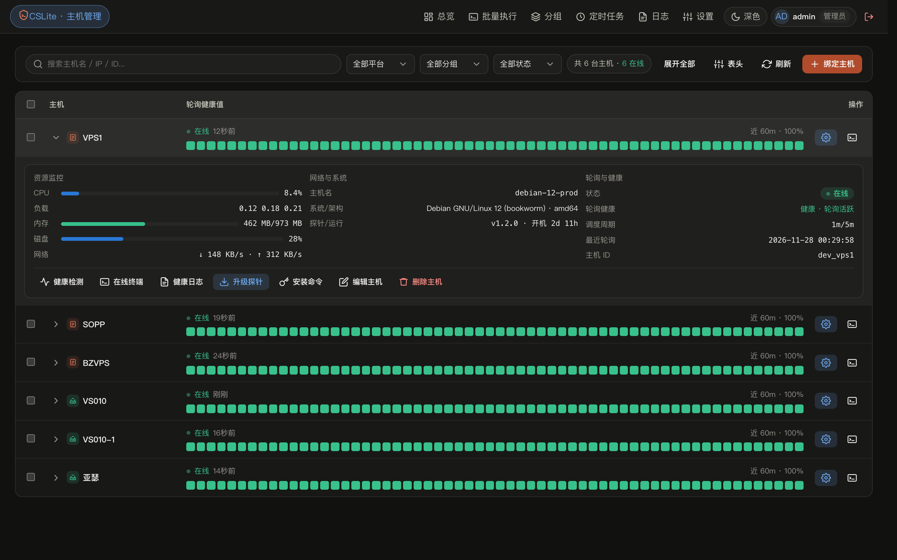
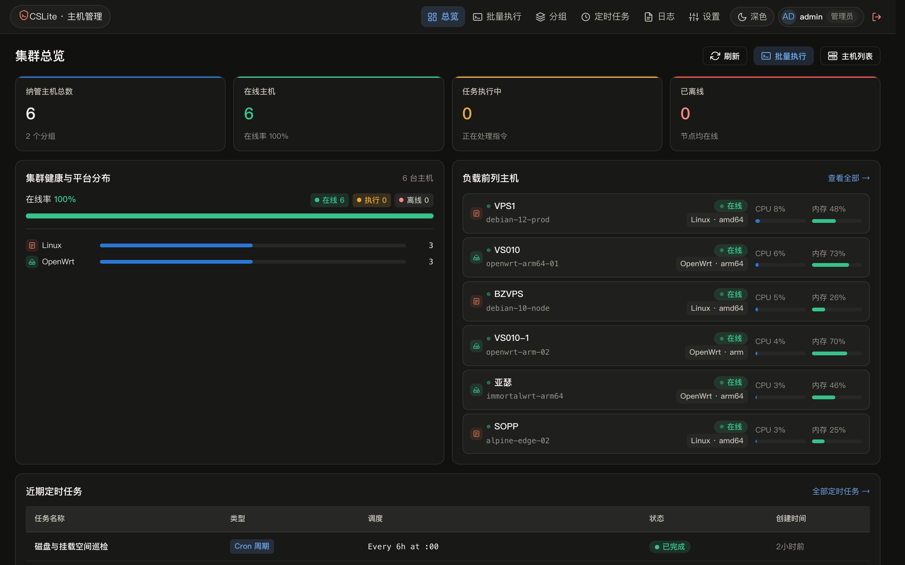
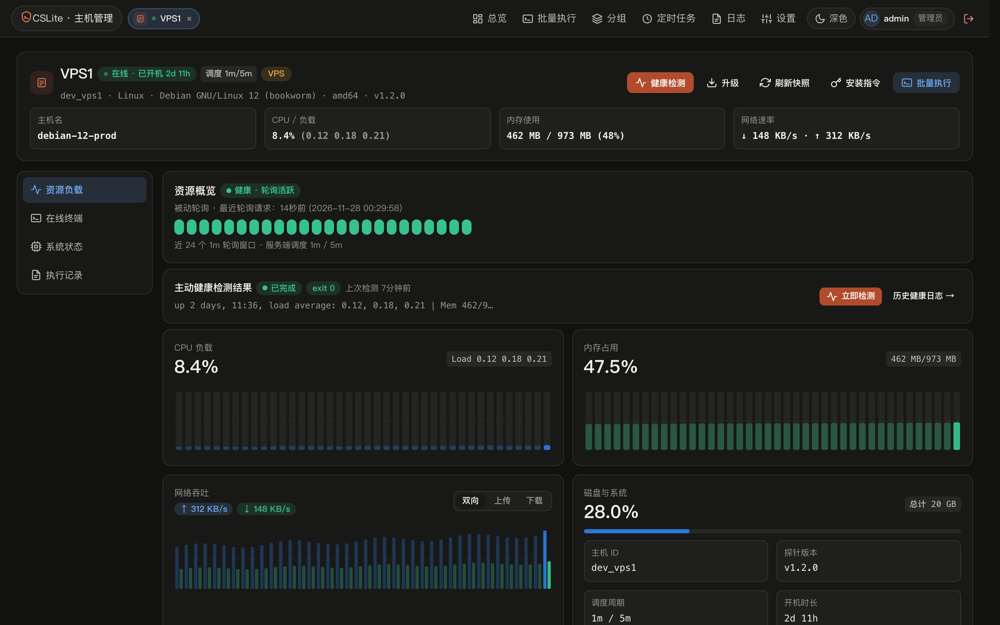
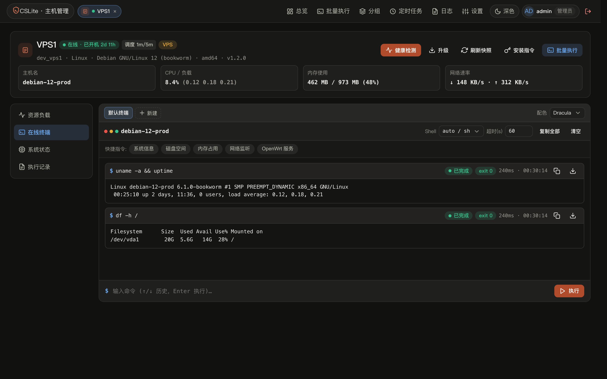
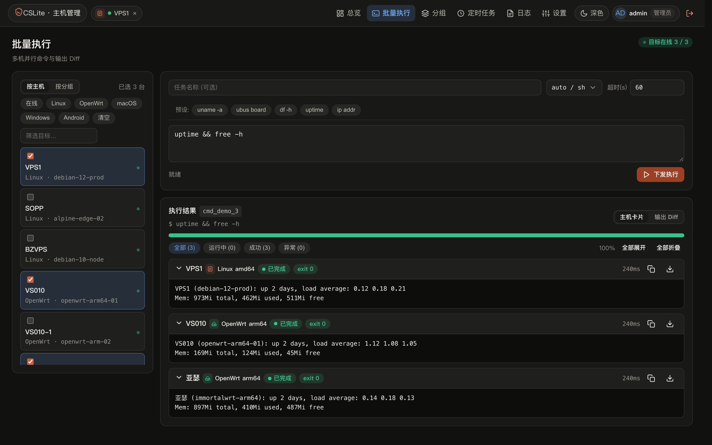
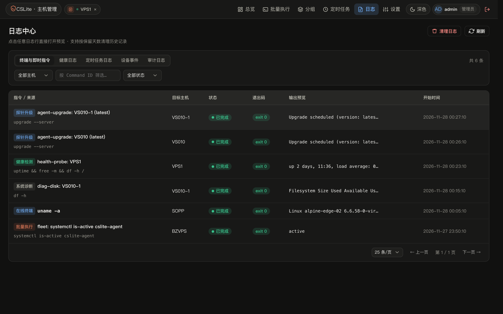
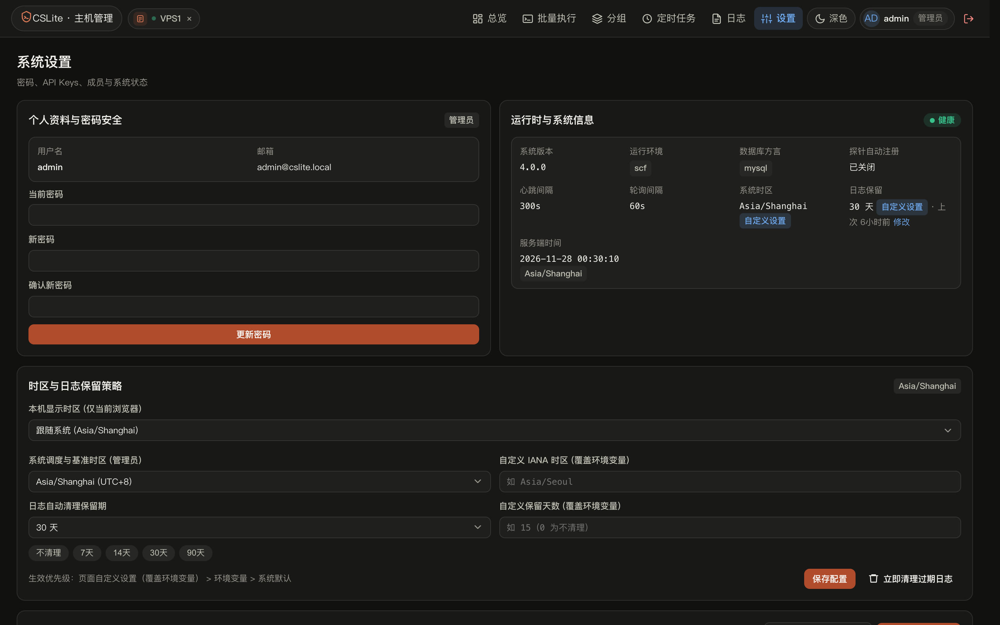
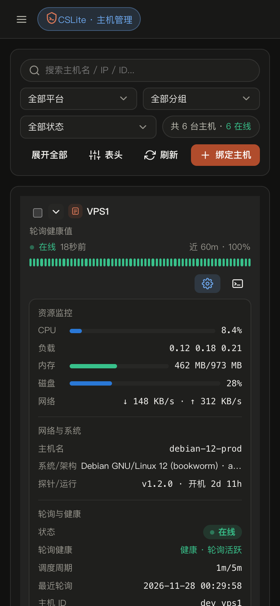

<div align="center">

# CSLite

**Lightweight Multi-Runtime Fleet Control & Remote Execution Platform**

English | [简体中文](./README.zh-CN.md)

[](#prerequisites)
[](#prerequisites)
[](#architecture-highlights)
[](../LICENSE)



</div>

---

CSLite is built for resource-constrained nodes and serverless environments — zero Redis, zero external message queues. Its portable Web Standards server (`TypeScript + Hono`) deploys identically to **Node.js**, **Cloudflare Workers + D1**, and **Tencent Cloud SCF**, while cross-platform agents run smoothly on **Linux**, **OpenWrt** (both static Go binary and BusyBox POSIX Lite shell), **Alpine**, **macOS**, **Windows**, and **Android (Termux)**.

---

## Screenshots

| Cluster Overview | Host Detail & Telemetry |
| :---: | :---: |
|  |  |
| **Online Terminal** | **Batch Console & Output Diff** |
|  |  |
| **Logs Center** | **System Settings & Retention** |
|  |  |

<p align="center">
  <strong>Mobile Responsive View</strong><br /><br />
  
</p>

---

## Key Features

- **Multi-Runtime Server (`server/`)**
  - **Node.js / Docker**: Built-in `node:sqlite` out of the box (Node `>= 22.5`), plus MySQL 8.x and Turso HTTP drivers.
  - **Cloudflare Workers**: Native Cloudflare D1 binding or Turso with zero Node runtime dependencies.
  - **Tencent Cloud SCF + CDN**: Supports Web Function (`scf_bootstrap` on port `9000`) and APIGW Event handler (`scf.main_handler`) behind Tencent Cloud CDN with origin-secret protection.
- **Single-File Zero-CDN Web UI (`web/`)**
  - Bundled into a single self-contained HTML artifact (`web/dist/index.html` & `server/src/ui-bundle.ts`) with zero external fonts or scripts, supporting Dark / Light / System themes and mobile screens.
  - **Fleet Host List & Health Timeline**: Customizable table columns (`Host`, `Poll Health`, `IP`, `Groups`, `Resource Load`), full-width 60-slot passive poll health matrix, zero-flicker inline expandable detail drawers, Hour/Day (`1h / 24h / 7d / 30d`) health timelines on Overview & Host Detail, click-to-copy IPv4/IPv6 addresses, and searchable multi-IP modal (up to 128 interface IPs per host).
  - **Online Terminal & Multi-Host Console**: Real-time command polling, multi-tab interactive command history, preset OS shortcuts, concurrent device/group targeting, and line-by-line **Output Diff**.
  - **Scheduling, Logs & System Retention**: `immediate`, `once`, and 5-field timezone-aware `cron` schedules; centralized Logs Center with click-to-preview rows, page size selector (`10 / 25 / 50 / 100`), throttled `heartbeat` telemetry logs, and configurable log retention + one-click cleanup.
- **Cross-Platform Agents (`agent/`)**
  - **Unified Single Version Source (`agent/VERSION`)**: Build and release workflows automatically keep the Go static binary (`//go:embed VERSION` + `-ldflags`), OpenWrt POSIX Lite script (`/agent-lite.sh`), PowerShell Lite script (`/agent-lite.ps1`), and `.ipk` package synchronized (`v1.2.1`).
  - **Service Integration**: Native management via `systemd` (`--user` or system), OpenWrt `procd` + UCI, OpenRC (Alpine), macOS `launchd`, Windows Service SCM, and Android Termux/root hooks.
  - **Server-Hosted Install & Self-Upgrade**: Zero-DB cached script routes (`/i`, `/i.ps1`, `/ia`, `/u`, `/u.ps1`, `/agent-lite.sh`, `/agent-lite.ps1`) with OpenWrt BusyBox fallback (`curl -> uclient-fetch -> wget -> openssl s_client`) and `HUP`/`TERM`-safe background self-upgrade.

---

## Quick Start

### Prerequisites

- **Node.js `>= 22.5`** (uses built-in `node:sqlite`)
- **Go `>= 1.24`** (for building or cross-compiling the Go agent binary)

### Start the Server Locally

```bash
# 1. Install Node dependencies and Go modules
make install

# 2. Build single-file Web UI and start Node dev server (SQLite: ./data/cslite.db)
make dev
```

Open `http://127.0.0.1:9000` in your browser. Default admin credentials: `admin` / `admin` (override via `CSLITE_ADMIN_PASSWORD` in production or change immediately in **Settings**).

### Common `Makefile` Targets

```bash
make build-web          # Assemble modular agent scripts & bundle web/dist/index.html + server/src/ui-bundle.ts
make typecheck          # Run strict TypeScript type checks (server + web)
make dev                # Start local Node server with watch mode
make dev-worker         # Run Cloudflare Workers locally (wrangler dev)
make deploy-worker      # Build Web UI and deploy to Cloudflare Workers
make build-scf          # Package Tencent Cloud SCF bundle -> deploy/scf/dist/cslite-scf.zip
make build-agent        # Build cslite-agent binary for the host OS/arch
make build-agent-all    # Cross-compile Go binaries for Linux / macOS / Windows -> dist/agent/
make build-openwrt-ipk  # Build OpenWrt .ipk packages -> dist/openwrt/
make docker-build       # Build multi-stage Node 22 Alpine Docker image
make test               # Run build-web + typecheck + vitest + go vet + go test -race
```

### Connect & Upgrade Agents

Bind a device in the Web UI to receive its device-scoped API key (`ak_dev_...`) and one-line installer command:

```bash
# Linux / OpenWrt / macOS (auto-selects Go binary or BusyBox Lite script)
curl -fsSL https://your-cslite-host/i | sh -s -- <api_key> [device_id] [name]

# Trigger in-place self-upgrade via UI "Upgrade Agent" button or /u script
sh /path/to/upgrade.sh --server https://your-cslite-host --version latest
```

```powershell
# Windows (PowerShell)
irm https://your-cslite-host/i.ps1 | iex
```

---

## Architecture Highlights

- **Serverless-Friendly Lazy Scheduling**: No long-running scheduler or Redis required. Scheduled `once` and 5-field `cron` commands store `next_run_at`; when an agent polls `/api/agent/commands`, due executions are lazily instantiated with a unique `(command_id, scheduled_for)` constraint and claimed atomically via `UPDATE execution_results SET status = 'running' ... WHERE id = ? AND status = 'queued'`.
- **Lazy Timeout Reaping**: `reapTimedOutExecutions` marks timed-out running tasks during command polling/inspection and reconciles parent execution and non-cron command states.
- **Zero-External-Asset Frontend**: Built with `esbuild` into a single `UI_HTML` string served directly from Worker / SCF / Node memory.
- **Security & Auth**: Browser sessions use `cslite_session` HttpOnly cookies (with same-origin / JSON header CSRF checks) or Bearer tokens; agents and programmatic callers authenticate via `X-API-Key` (`ak_dev_*` device-bound or `ak_live_*` scoped keys).

---

## Documentation Index

- **Deployment Guide** (Node / Docker / Cloudflare Workers + D1 / Tencent Cloud SCF + CDN / Multi-Platform Agents): [`docs/deploy.md`](./deploy.md)
- **Server Architecture & Schema**:
  - [`docs/server/overview.md`](./server/overview.md)
  - [`docs/server/data-models.md`](./server/data-models.md)
- **Server API Reference**:
  - Auth & Users (`/api/auth/*`): [`docs/server/api/auth.md`](./server/api/auth.md)
  - Devices & Groups (`/api/devices/*`, `/api/groups/*`): [`docs/server/api/devices.md`](./server/api/devices.md)
  - Commands & Executions (`/api/commands/*`): [`docs/server/api/commands.md`](./server/api/commands.md)
  - Permissions & Auth Model: [`docs/server/api/permissions.md`](./server/api/permissions.md)
- **Agent Protocol Reference** (`/api/agent/*`): [`docs/agent/api.md`](./agent/api.md)
- **Development & Operations**:
  - Environment Variables: [`docs/development/environment.md`](./development/environment.md)
  - Error Codes: [`docs/development/error-codes.md`](./development/error-codes.md)
  - Best Practices: [`docs/development/best-practices.md`](./development/best-practices.md)
  - Plans: [`docs/development/plans.md`](./development/plans.md)
  - Important Notes (中文): [`docs/注意事项.md`](./注意事项.md)

---

## Project Structure

```text
├── shared/                    # Frozen v1 TypeScript DTOs & error codes shared across runtimes
│   └── types.ts
├── server/                    # Multi-runtime Hono backend (TypeScript)
│   ├── migrations/            # Cloudflare D1 SQL migrations
│   ├── src/
│   │   ├── app.ts             # Portable Web-Standards Hono router & script endpoints
│   │   ├── config.ts          # Runtime-agnostic config loader
│   │   ├── entry-node.ts      # Node.js entry (node:sqlite / MySQL / Turso)
│   │   ├── entry-worker.ts    # Cloudflare Workers entry (D1 / Turso)
│   │   ├── entry-scf.ts       # Tencent Cloud SCF APIGW handler
│   │   ├── db/                # SQL drivers (d1 / node-sqlite / mysql / turso) & migrations
│   │   ├── lib/               # Crypto, Cron parser, timezone, cleanup & reconciliation
│   │   ├── middleware/        # Cookie / Bearer / API key auth & CSRF protection
│   │   └── routes/            # auth / devices / groups / commands / agent / logs / system
│   ├── test/                  # Vitest API, adapter & concurrency suites
│   └── wrangler.toml          # Cloudflare Workers & D1 config
├── web/                       # Single-file SPA frontend (TypeScript + CSS)
│   ├── build.mjs              # esbuild bundler & modular agent script assembler
│   ├── src/                   # Router, API client, components & views
│   └── test/                  # Web build & component unit tests
├── agent/                     # Cross-platform Go agent, OpenWrt & modular scripts
│   ├── VERSION                # Single version source synced across Go, Shell, PS1 & IPK
│   ├── main.go                # CLI entry (run/install/uninstall/start/stop/restart/status/exec)
│   ├── internal/              # client / config / core / exec / metrics / protocol / service / state
│   ├── openwrt/               # procd init, UCI config, modular lite/ sources & build-ipk.sh
│   └── scripts/               # Modular install/, upgrade/, upgrade.ps1 & cslite-agent-lite.ps1
├── deploy/                    # Container & SCF packaging
│   ├── docker/Dockerfile      # Multi-stage Node 22 Alpine image
│   └── scf/                   # Tencent Cloud SCF bootstrap & bundler
├── docs/                      # Documentation, screenshots & bilingual READMEs
│   ├── README.md              # English README
│   ├── README.zh-CN.md        # 简体中文 README
│   └── screenshots/           # Desktop & mobile UI screenshots
├── Makefile
└── package.json
```
