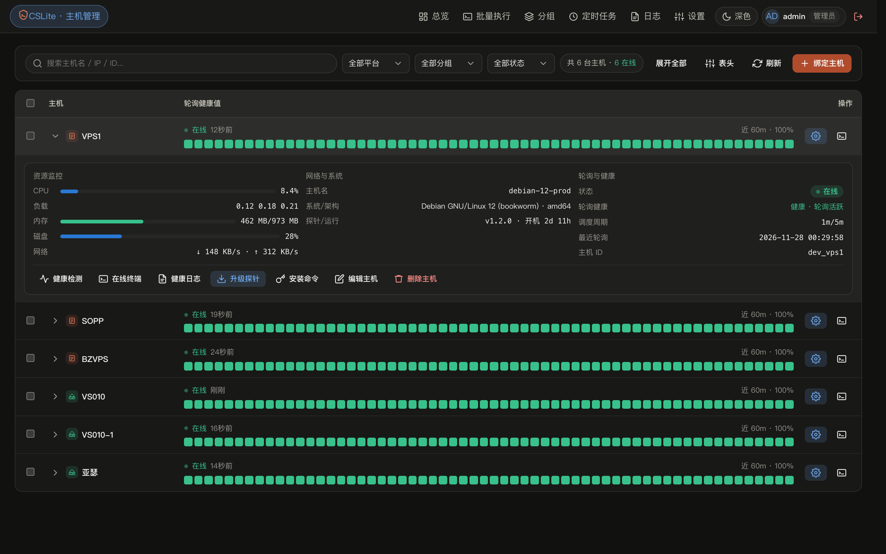
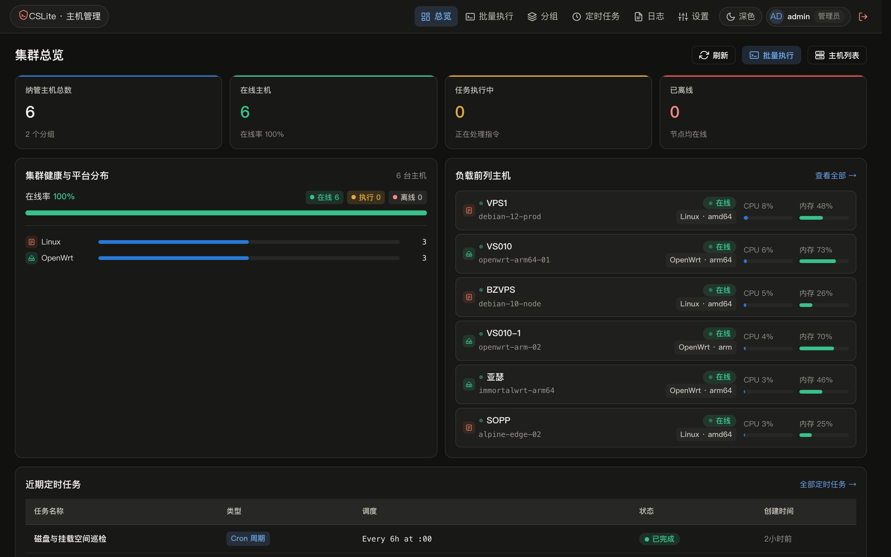
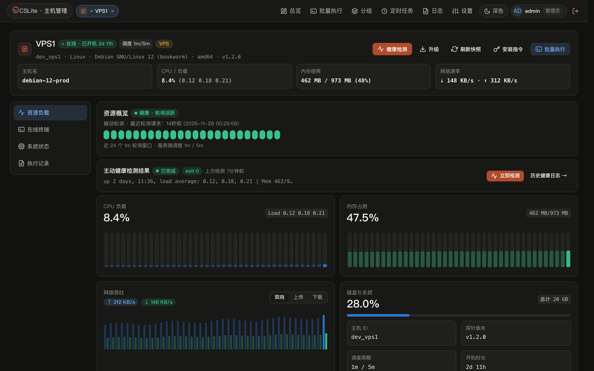
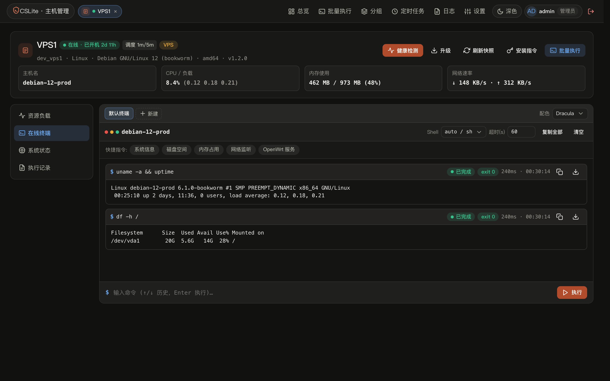
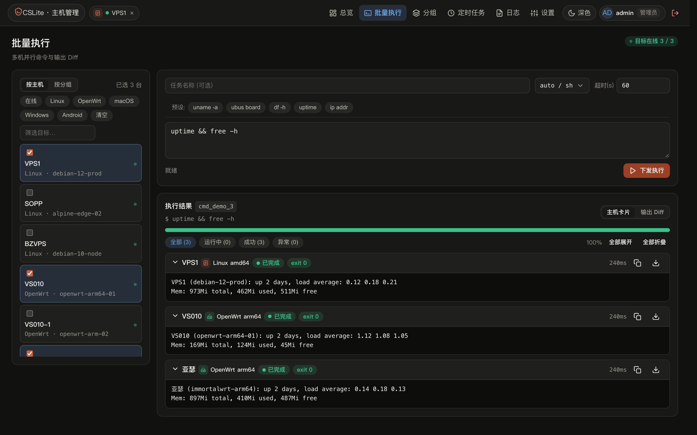
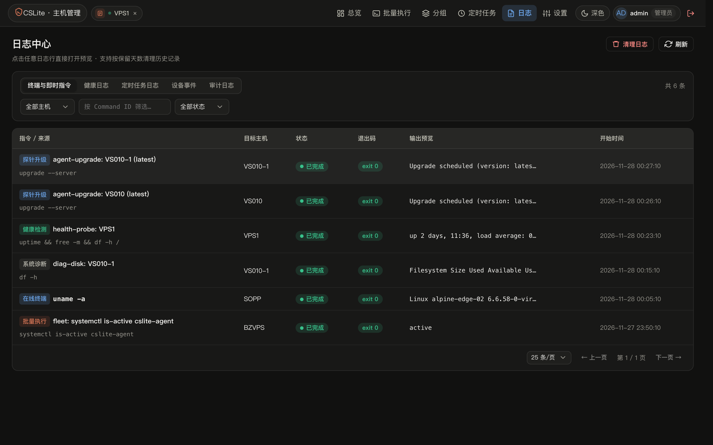
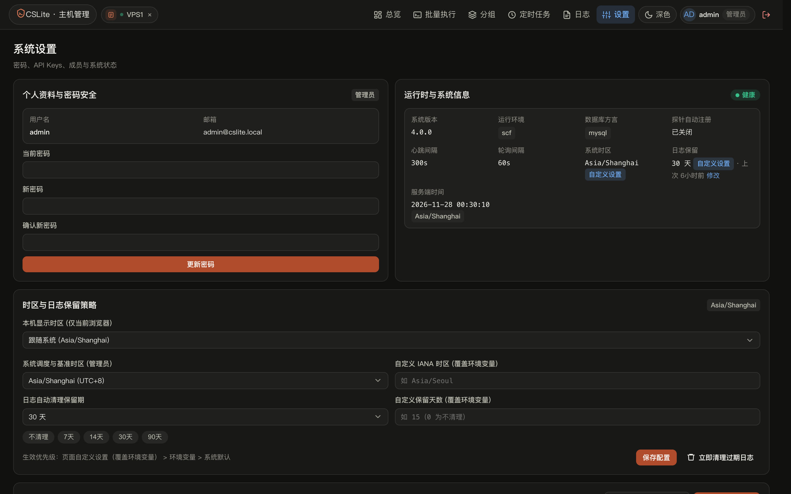
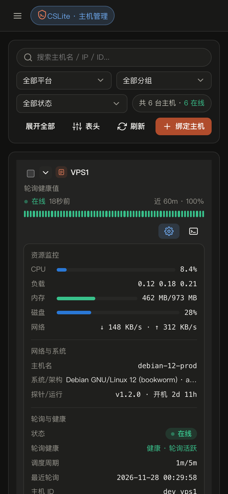

<div align="center">

# CSLite

**轻量级多运行时节点控制与批量执行平台**

[English](./README.md) | 简体中文

[](#1-环境准备)
[](#1-环境准备)
[](#设计摘要)
[](../LICENSE)



</div>

---

CSLite 面向资源受限设备与无服务器（Serverless）场景打造：零 Redis、零消息队列。服务端采用纯 Web Standards 架构（`TypeScript + Hono`），可无缝部署至 **Node.js**、**Cloudflare Workers + D1** 与 **腾讯云 SCF**；客户端探针同时提供静态 Go 全量版与轻量脚本版，全面适配 **Linux**、**OpenWrt**、**Alpine**、**macOS**、**Windows** 与 **Android（Termux）**。

---

## 界面预览

| 集群总览 | 节点详情与资源监控 |
| :---: | :---: |
|  |  |
| **在线终端** | **批量执行与输出 Diff** |
|  |  |
| **日志中心** | **系统设置与保留策略** |
|  |  |

<p align="center">
  <strong>移动端自适应视图</strong><br /><br />
  
</p>

---

## 核心特性

- **多运行时服务端（`server/`）**
  - **Node.js / Docker**：Node `>= 22.5` 内置 `node:sqlite` 开箱即用，亦支持 MySQL 与 Turso。
  - **Cloudflare Workers**：原生绑定 D1 数据库或通过 HTTP 接入 Turso，零 Node 依赖。
  - **腾讯云 SCF + CDN**：同时支持 Web Function（`scf_bootstrap` 监听 `9000` 端口）与 APIGW 事件函数（`scf.main_handler`），可搭配腾讯云 CDN 回源鉴权与缓存策略部署。
- **单文件零外部依赖前端（`web/`）**
  - 打包为单一自包含 HTML（`web/dist/index.html` 与 `server/src/ui-bundle.ts`），无外部字体或 CDN 脚本依赖，支持深色 / 浅色 / 跟随系统主题与移动端深度适配。
  - **主机管理列表与健康时间轴**：支持右上角自定义表头列（默认精简为 `主机` / `轮询健康值` / `操作`），满宽 60 格轮询健康脉搏条，概览与节点详情页支持小时 / 天（`1h / 24h / 7d / 30d`）健康趋势切换，点击整行零闪烁展开详情抽屉，IPv4/IPv6 点击直接复制，并支持多 IP 弹窗检索与一键复制（单机最高 128 个接口 IP）。
  - **在线终端与批量执行**：支持实时命令轮询、多标签历史回溯、平台快捷指令、多主机/多分组并发下发及逐行 **Output Diff** 对比。
  - **调度、日志与自动清理**：支持立即指令（`immediate`）、一次性预约（`once`）与时区感知 Cron 周期任务；日志中心支持整行点击预览、分页大小切换（`10 / 25 / 50 / 100`）、节流心跳健康记录以及可配置的日志保留期与手动清理。
- **跨平台轻量探针（`agent/`）**
  - **统一单点版本管理（`agent/VERSION`）**：通过 `web/build.mjs`、Go `//go:embed VERSION` 与发布流水线，自动保持 Go 二进制、OpenWrt POSIX Lite 脚本（`/agent-lite.sh`）、Windows PowerShell Lite 脚本（`/agent-lite.ps1`）及 `.ipk` 包版本一致（`v1.2.2`）。
  - **原生服务守护**：支持 Linux `systemd`（系统级与 `--user`）、Alpine `OpenRC`、OpenWrt `procd` + UCI、macOS `launchd`、Windows Service SCM 以及 Android 启动挂钩。
  - **服务端托管安装与平滑自升级**：提供 `/i`、`/i.ps1`、`/ia`、`/u`、`/u.ps1`、`/agent-lite.sh`、`/agent-lite.ps1` 零库脚本路由；兼容 OpenWrt BusyBox（`curl -> uclient-fetch -> wget -> openssl s_client` 顺序回退）及无 `nohup` 下的 `HUP`/`TERM` 防断自升级重启。

---

## 快速开始

### 1. 环境准备

- **Node.js `>= 22.5`**（使用内置 `node:sqlite` 驱动）
- **Go `>= 1.24`**（编译或交叉编译 Go Agent 二进制时需要）

### 2. 本地启动服务端

```bash
# 安装 Node 依赖与 Go 模块
make install

# 构建单文件前端并以开发热重载模式启动 Node 服务（默认 SQLite: ./data/cslite.db）
make dev
```

浏览器访问 `http://127.0.0.1:9000`。默认管理员账号为 `admin` / `admin`（生产环境请配置 `CSLITE_ADMIN_PASSWORD` 或登录后在 **设置** 页面修改密码）。

### 3. 常用命令

```bash
make build-web          # 拼装模块化探针脚本并构建 web/dist/index.html 与 server/src/ui-bundle.ts
make typecheck          # 严格 TypeScript 类型检查（服务端与前端）
make dev                # 启动本地 Node 开发服务
make dev-worker         # 本地启动 Cloudflare Workers (wrangler dev)
make deploy-worker      # 构建前端并部署至 Cloudflare Workers
make build-scf          # 构建腾讯云 SCF 部署包 -> deploy/scf/dist/cslite-scf.zip
make build-agent        # 编译当前平台 cslite-agent 二进制
make build-agent-all    # 交叉编译全平台 cslite-agent 二进制 -> dist/agent/
make build-openwrt-ipk  # 构建 OpenWrt .ipk 安装包 -> dist/openwrt/
make docker-build       # 构建多阶段 Node 22 Alpine Docker 镜像
make test               # 全链路验证（build-web + typecheck + vitest + go vet + go test -race）
```

### 4. 快速接入与升级探针

在 Web 控制台点击 **绑定主机** 生成设备专属绑定密钥（`ak_dev_...`）及安装命令：

```bash
# Linux / OpenWrt / macOS（自动匹配 Go 二进制或 BusyBox 极简脚本版）
curl -fsSL https://your-cslite-host/i | sh -s -- <api_key> [device_id] [name]

# 在控制台直接点击“升级探针”，或在终端执行平滑升级脚本
sh /path/to/upgrade.sh --server https://your-cslite-host --version latest
```

```powershell
# Windows（PowerShell）
irm https://your-cslite-host/i.ps1 | iex
```

---

## 设计摘要

- **无长驻调度器，原生支持 Serverless**：不依赖 Redis 或常驻 Cron 守护进程；`once` 与 5 字段 `cron` 命令存储 `next_run_at`，在 Agent 轮询 `/api/agent/commands` 时依托 `(command_id, scheduled_for)` 唯一索引与原子 `UPDATE execution_results SET status = 'running' ... WHERE id = ? AND status = 'queued'` 惰性实例化并防重抢占。
- **惰性超时回收**：查询命令详情或 Agent 轮询时由 `reapTimedOutExecutions` 自动标记超时任务并收敛父执行与一次性命令状态。
- **单文件内嵌前端**：`web/` 通过 `esbuild` 打包内嵌于 `server/src/ui-bundle.ts`，支持 Cloudflare Workers 与 SCF 单包部署。
- **认证与安全**：Web 会话使用 `cslite_session` HttpOnly Cookie（写请求校验同源或 JSON CSRF 头）与 Bearer 令牌；探针与 API 调用方支持 `X-API-Key`（支持单机绑定密钥 `ak_dev_*` 与全局/兼容密钥 `ak_live_*`）。

---

## 文档导航

- **部署全指南**（Node / Docker / Cloudflare Workers + D1 / 腾讯云 SCF + CDN / 多平台 Agent）：[`docs/deploy.md`](./deploy.md)
- **服务端概览与数据模型**：
  - [`docs/server/overview.md`](./server/overview.md)
  - [`docs/server/data-models.md`](./server/data-models.md)
- **服务端 API 文档**：
  - 认证与用户 `/api/auth/*`：[`docs/server/api/auth.md`](./server/api/auth.md)
  - 设备与分组 `/api/devices/*`、`/api/groups/*`：[`docs/server/api/devices.md`](./server/api/devices.md)
  - 命令与执行 `/api/commands/*`：[`docs/server/api/commands.md`](./server/api/commands.md)
  - 权限与认证机制：[`docs/server/api/permissions.md`](./server/api/permissions.md)
- **Agent 通信协议**（`/api/agent/*`）：[`docs/agent/api.md`](./agent/api.md)
- **开发与运维参考**：
  - 环境变量配置：[`docs/development/environment.md`](./development/environment.md)
  - 错误码参考：[`docs/development/error-codes.md`](./development/error-codes.md)
  - 最佳实践：[`docs/development/best-practices.md`](./development/best-practices.md)
  - 计划事项：[`docs/development/plans.md`](./development/plans.md)
  - 注意事项：[`docs/注意事项.md`](./注意事项.md)

---

## 项目结构

```text
├── shared/                    # 前后端共享冻结契约 v1（DTO 与错误码）
│   └── types.ts
├── server/                    # Hono 多运行时服务端（TypeScript）
│   ├── migrations/            # Cloudflare D1 SQL 迁移脚本
│   ├── src/
│   │   ├── app.ts             # 可移植 Web-Standards Hono 核心与脚本托管路由
│   │   ├── config.ts          # 运行时无关配置解析
│   │   ├── entry-node.ts      # Node.js 入口（node:sqlite / MySQL / Turso）
│   │   ├── entry-worker.ts    # Cloudflare Workers 入口（D1 / Turso）
│   │   ├── entry-scf.ts       # 腾讯云 SCF API 网关事件入口
│   │   ├── db/                # 数据库驱动（d1 / node-sqlite / mysql / turso）与 Schema
│   │   ├── lib/               # 加密、Cron 解析、时区、日志清理与状态收敛
│   │   ├── middleware/        # Cookie / Bearer / API Key 认证与 CSRF 中间件
│   │   └── routes/            # auth / devices / groups / commands / agent / logs / system
│   ├── test/                  # Vitest 接口、适配器与并发测试
│   └── wrangler.toml          # Cloudflare Workers 与 D1 配置
├── web/                       # 单文件 SPA 前端（TypeScript + CSS）
│   ├── build.mjs              # esbuild 构建与模块化探针脚本拼装器
│   ├── src/                   # 路由、API 客户端、组件与视图
│   └── test/                  # 前端构建与组件单元测试
├── agent/                     # 跨平台 Go Agent、OpenWrt 与模块化安装/升级脚本
│   ├── VERSION                # 统一版本真源（同步 Go / Shell / PS1 / IPK）
│   ├── main.go                # CLI 入口（run/install/uninstall/start/stop/restart/status/exec）
│   ├── internal/              # client / config / core / exec / metrics / protocol / service / state
│   ├── openwrt/               # procd init、UCI 配置、模块化 lite/ 源码与 build-ipk.sh
│   └── scripts/               # 模块化 install/、upgrade/、upgrade.ps1 与 cslite-agent-lite.ps1
├── deploy/                    # 部署打包配置
│   ├── docker/Dockerfile      # Node 22 Alpine 多阶段镜像
│   └── scf/                   # 腾讯云 SCF 引导脚本与打包器
├── docs/                      # 项目文档、界面截图与双语 README
│   ├── README.md              # 英文文档入口
│   ├── README.zh-CN.md        # 简体中文 README
│   └── screenshots/           # 桌面端与移动端 UI 截图
├── Makefile
└── package.json
```
