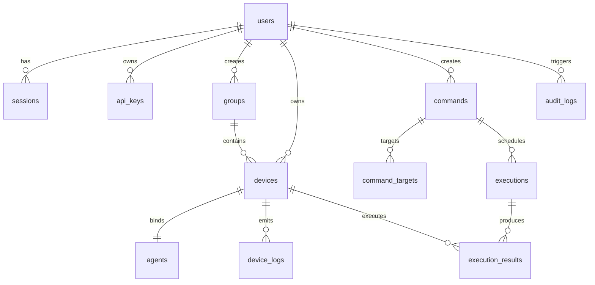

# 数据模型与数据库 Schema

> **权威定义**: [`server/migrations/0001_init.sql`](../../server/migrations/0001_init.sql)、[`server/src/db/schema.ts`](../../server/src/db/schema.ts)、[`shared/types.ts`](../../shared/types.ts)

服务端通过统一的 `SqlDriver` 抽象（[`server/src/db/driver.ts`](../../server/src/db/driver.ts)）同时兼容 **SQLite**（`node:sqlite` / Cloudflare D1 / Turso）与 **MySQL**（`mysql2`），所有表与查询均避免方言专属 JSON 函数（例如不使用 MySQL 专有的 `JSON_CONTAINS`，而是使用规范化的 `command_targets` 关联表）。

---

## ER 关系图

---

## 核心表结构（共 12 张表）

### 1. `users`（用户表）

| 字段名          | 类型（SQLite / MySQL）       | 说明                         | 约束 / 默认值             |
| --------------- | ---------------------------- | ---------------------------- | ------------------------- |
| `id`            | INTEGER / INT AUTO_INCREMENT | 用户唯一 ID                  | `PRIMARY KEY`             |
| `username`      | TEXT / VARCHAR(191)          | 用户名                       | `NOT NULL UNIQUE`         |
| `password_hash` | TEXT / VARCHAR(255)          | PBKDF2-SHA256 哈希           | `NOT NULL`                |
| `email`         | TEXT / VARCHAR(255)          | 邮箱地址                     | `NOT NULL DEFAULT ''`     |
| `role`          | INTEGER / INT                | 角色：`0` 普通用户，`1` 管理员 | `NOT NULL DEFAULT 0`    |
| `created_at`    | TEXT / VARCHAR(32)           | 创建时间（ISO-8601 UTC）     | `NOT NULL`                |
| `updated_at`    | TEXT / VARCHAR(32)           | 更新时间（ISO-8601 UTC）     | `NOT NULL`                |

> 首次迁移会自动种子创建默认管理员（默认 `admin` / `admin`，可通过 `CSLITE_ADMIN_USERNAME` 与 `CSLITE_ADMIN_PASSWORD` 覆盖）。

### 2. `sessions`（会话表）

| 字段名       | 类型                | 说明                         | 约束               |
| ------------ | ------------------- | ---------------------------- | ------------------ |
| `id`         | TEXT / VARCHAR(64)  | 会话记录 ID（`sess_...`）    | `PRIMARY KEY`      |
| `user_id`    | INTEGER / INT       | 所属用户 ID                  | `NOT NULL` + 索引  |
| `token_hash` | TEXT / VARCHAR(128) | 会话令牌 SHA-256 十六进制摘要 | `NOT NULL UNIQUE`  |
| `expires_at` | TEXT / VARCHAR(32)  | 过期时间（ISO-8601 UTC）     | `NOT NULL` + 索引  |
| `created_at` | TEXT / VARCHAR(32)  | 创建时间                     | `NOT NULL`         |

### 3. `api_keys`（API Key 表）

| 字段名       | 类型                | 说明                           | 约束               |
| ------------ | ------------------- | ------------------------------ | ------------------ |
| `id`         | TEXT / VARCHAR(64)  | 密钥 ID（`key_...`）           | `PRIMARY KEY`      |
| `user_id`    | INTEGER / INT       | 所属用户 ID                    | `NOT NULL` + 索引  |
| `name`       | TEXT / VARCHAR(191) | 密钥备注名称                   | `NOT NULL`         |
| `key_hash`   | TEXT / VARCHAR(128) | `ak_live_...` 的 SHA-256 摘要  | `NOT NULL UNIQUE`  |
| `key_prefix` | TEXT / VARCHAR(32)  | 脱敏展示前缀（前 12 字符 + `...`） | `NOT NULL`     |
| `last_used`  | TEXT / VARCHAR(32)  | 最近使用时间（5 分钟节流更新） | 可空               |
| `created_at` | TEXT / VARCHAR(32)  | 创建时间                       | `NOT NULL`         |

### 4. `groups`（设备分组表）

| 字段名        | 类型                  | 说明           | 约束               |
| ------------- | --------------------- | -------------- | ------------------ |
| `id`          | TEXT / VARCHAR(64)    | 分组 ID（`grp_...`） | `PRIMARY KEY` |
| `name`        | TEXT / VARCHAR(191)   | 分组名称       | `NOT NULL`         |
| `description` | TEXT / VARCHAR(1000)  | 分组描述       | `NOT NULL DEFAULT ''` |
| `created_by`  | INTEGER / INT         | 创建者用户 ID  | `NOT NULL` + 索引  |
| `created_at`  | TEXT / VARCHAR(32)    | 创建时间       | `NOT NULL`         |
| `updated_at`  | TEXT / VARCHAR(32)    | 更新时间       | `NOT NULL`         |

### 5. `devices`（设备表）

| 字段名          | 类型                | 说明                                 | 约束 / 默认值             |
| --------------- | ------------------- | ------------------------------------ | ------------------------- |
| `id`            | TEXT / VARCHAR(64)  | 设备 ID（`dev_...`）                 | `PRIMARY KEY`             |
| `name`          | TEXT / VARCHAR(191) | 设备名称                             | `NOT NULL`                |
| `platform`      | TEXT / VARCHAR(64)  | 平台标识（`linux`/`openwrt`/`macos`/`windows` 等） | `NOT NULL` |
| `arch`          | TEXT / VARCHAR(64)  | CPU 架构（如 `amd64`/`arm64`/`mipsle`） | `NOT NULL DEFAULT ''` |
| `os_version`    | TEXT / VARCHAR(191) | 操作系统版本描述                     | `NOT NULL DEFAULT ''`     |
| `hostname`      | TEXT / VARCHAR(191) | 主机名                               | `NOT NULL DEFAULT ''`     |
| `status`        | TEXT / VARCHAR(32)  | 存储状态（输出时依据 `last_seen` 实时计算） | `NOT NULL DEFAULT 'offline'` + 索引 |
| `owner_id`      | INTEGER / INT       | 归属用户 ID                          | `NOT NULL` + 索引         |
| `group_id`      | TEXT / VARCHAR(64)  | 所属分组 ID                          | 可空 + 索引               |
| `ip_address`    | TEXT / VARCHAR(64)  | 最近上报或识别的客户端 IP            | `NOT NULL DEFAULT ''`     |
| `agent_id`      | TEXT / VARCHAR(64)  | 绑定的 Agent ID                      | 可空 + 索引               |
| `agent_version` | TEXT / VARCHAR(64)  | Agent 版本                           | `NOT NULL DEFAULT ''`     |
| `metrics_json`  | TEXT                | 最近一次心跳遥测 `DeviceMetrics` JSON | 可空                     |
| `last_seen`     | TEXT / VARCHAR(32)  | 最近心跳或轮询活动时间（用于在线判定） | `NOT NULL DEFAULT ''`   |
| `expires_at`    | TEXT / VARCHAR(32)  | 预创建槽位安装令牌过期时间           | 可空                      |
| `created_at`    | TEXT / VARCHAR(32)  | 创建时间                             | `NOT NULL`                |
| `updated_at`    | TEXT / VARCHAR(32)  | 更新时间                             | `NOT NULL`                |

### 6. `agents`（Agent 实例表）

| 字段名              | 类型                | 说明                 | 约束 / 默认值            |
| ------------------- | ------------------- | -------------------- | ------------------------ |
| `id`                | TEXT / VARCHAR(64)  | Agent ID（`agent_...`） | `PRIMARY KEY`         |
| `device_id`         | TEXT / VARCHAR(64)  | 绑定设备 ID          | `NOT NULL UNIQUE`        |
| `owner_id`          | INTEGER / INT       | 归属用户 ID          | `NOT NULL` + 索引        |
| `version`           | TEXT / VARCHAR(64)  | Agent 版本           | `NOT NULL DEFAULT ''`    |
| `status`            | TEXT / VARCHAR(32)  | 状态（默认 `active`） | `NOT NULL DEFAULT 'active'` |
| `last_heartbeat`    | TEXT / VARCHAR(32)  | 最近心跳时间         | `NOT NULL`               |
| `heartbeat_metrics` | TEXT                | 心跳指标 JSON        | 可空                     |
| `created_at`        | TEXT / VARCHAR(32)  | 创建时间             | `NOT NULL`               |
| `updated_at`        | TEXT / VARCHAR(32)  | 更新时间             | `NOT NULL`               |

### 7. `commands`（命令定义表）

| 字段名              | 类型                  | 说明                                            | 约束 / 默认值                  |
| ------------------- | --------------------- | ----------------------------------------------- | ------------------------------ |
| `id`                | TEXT / VARCHAR(64)    | 命令 ID（`cmd_...`）                            | `PRIMARY KEY`                  |
| `name`              | TEXT / VARCHAR(191)   | 命令名称                                        | `NOT NULL`                     |
| `type`              | TEXT / VARCHAR(32)    | `immediate` / `once` / `cron`                   | `NOT NULL` + 索引              |
| `schedule`          | TEXT / VARCHAR(128)   | 5 字段 UTC Cron 或 ISO-8601 计划时间            | `NOT NULL DEFAULT ''`          |
| `content`           | TEXT / MEDIUMTEXT     | 执行脚本/命令正文                               | `NOT NULL`                     |
| `target_type`       | TEXT / VARCHAR(32)    | `devices` / `groups`                            | `NOT NULL`                     |
| `target_ids_json`   | TEXT                  | 目标 ID 数组的 JSON 字符串                      | `NOT NULL`                     |
| `timeout`           | INTEGER / INT         | 超时秒数（1-86400）                             | `NOT NULL DEFAULT 1800`        |
| `shell`             | TEXT / VARCHAR(64)    | 指定 Shell（如 `sh`/`bash`/`ash`/`cmd`/`powershell`） | `NOT NULL DEFAULT ''`     |
| `retry_policy_json` | TEXT                  | 重试策略 JSON                                   | 可空                           |
| `env_vars_json`     | TEXT                  | 环境变量 JSON Map                               | 可空                           |
| `status`            | TEXT / VARCHAR(32)    | `pending`/`running`/`completed`/`failed`/`paused`/`cancelled` | `NOT NULL DEFAULT 'pending'` |
| `next_run_at`       | TEXT / VARCHAR(32)    | 下次触发时间（ISO-8601 UTC）                    | 可空 + `(status, next_run_at)` 索引 |
| `created_by`        | INTEGER / INT         | 创建者用户 ID                                   | `NOT NULL` + 索引              |
| `created_at`        | TEXT / VARCHAR(32)    | 创建时间                                        | `NOT NULL`                     |
| `updated_at`        | TEXT / VARCHAR(32)    | 更新时间                                        | `NOT NULL`                     |

### 8. `command_targets`（命令目标关联表）

| 字段名        | 类型               | 说明                 | 约束                                     |
| ------------- | ------------------ | -------------------- | ---------------------------------------- |
| `command_id`  | TEXT / VARCHAR(64) | 命令 ID              | 复合主键 `(command_id, target_type, target_id)` |
| `target_type` | TEXT / VARCHAR(32) | `devices` / `groups` | 复合主键 + `(target_type, target_id)` 索引 |
| `target_id`   | TEXT / VARCHAR(64) | 设备或分组 ID        | 复合主键                                 |

### 9. `executions`（执行批次表）

| 字段名          | 类型               | 说明                             | 约束                                       |
| --------------- | ------------------ | -------------------------------- | ------------------------------------------ |
| `id`            | TEXT / VARCHAR(64) | 执行 ID（`exec_...`）            | `PRIMARY KEY`                              |
| `command_id`    | TEXT / VARCHAR(64) | 关联命令 ID                      | `NOT NULL` + 索引                          |
| `status`        | TEXT / VARCHAR(32) | `queued`/`running`/`completed`/`failed`/`timeout`/`cancelled` | `NOT NULL DEFAULT 'queued'` + 索引 |
| `scheduled_for` | TEXT / VARCHAR(32) | 计划触发时间槽（幂等防重）       | 可空，`UNIQUE (command_id, scheduled_for)` |
| `started_at`    | TEXT / VARCHAR(32) | 开始时间                         | `NOT NULL`                                 |
| `completed_at`  | TEXT / VARCHAR(32) | 完成时间                         | 可空                                       |
| `created_at`    | TEXT / VARCHAR(32) | 创建时间                         | `NOT NULL`                                 |

### 10. `execution_results`（单设备执行结果表）

| 字段名         | 类型                | 说明                              | 约束                                    |
| -------------- | ------------------- | --------------------------------- | --------------------------------------- |
| `id`           | TEXT / VARCHAR(64)  | 结果 ID（`res_...`）              | `PRIMARY KEY`                           |
| `execution_id` | TEXT / VARCHAR(64)  | 所属执行 ID                       | `NOT NULL` + 索引                       |
| `command_id`   | TEXT / VARCHAR(64)  | 所属命令 ID                       | `NOT NULL` + 索引                       |
| `device_id`    | TEXT / VARCHAR(64)  | 目标设备 ID                       | `NOT NULL`，`UNIQUE (execution_id, device_id)` |
| `status`       | TEXT / VARCHAR(32)  | `queued`/`running`/`completed`/`failed`/`timeout`/`cancelled` | `NOT NULL DEFAULT 'queued'` |
| `exit_code`    | INTEGER / INT       | 进程退出码                        | `NOT NULL DEFAULT 0`                    |
| `output`       | TEXT / MEDIUMTEXT   | 截断后的命令输出                  | `NOT NULL DEFAULT ''`                   |
| `log_content`  | TEXT / MEDIUMTEXT   | 完整上传或解码日志内容（上限 256 KiB） | 可空                               |
| `timeout_at`   | TEXT / VARCHAR(32)  | 超时截止时间（用于惰性回收）      | 可空 + `(status, timeout_at)` 索引      |
| `started_at`   | TEXT / VARCHAR(32)  | Agent 认领执行时间                | 可空                                    |
| `completed_at` | TEXT / VARCHAR(32)  | 上报/完成时间                     | 可空                                    |
| `created_at`   | TEXT / VARCHAR(32)  | 创建时间                          | `NOT NULL`                              |
| `updated_at`   | TEXT / VARCHAR(32)  | 更新时间                          | `NOT NULL`                              |

### 11. `device_logs`（设备事件日志表）

| 字段名          | 类型               | 说明                                  | 约束              |
| --------------- | ------------------ | ------------------------------------- | ----------------- |
| `id`            | TEXT / VARCHAR(64) | 日志 ID（`dlog_...`）                 | `PRIMARY KEY`     |
| `device_id`     | TEXT / VARCHAR(64) | 关联设备 ID                           | `NOT NULL`        |
| `type`          | TEXT / VARCHAR(64) | 事件类型（如 `register`、`command_result`、`command_timeout`） | `NOT NULL` |
| `timestamp`     | TEXT / VARCHAR(32) | 发生时间                              | `NOT NULL`        |
| `message`       | TEXT               | 事件描述                              | `NOT NULL`        |
| `metadata_json` | TEXT               | 结构化上下文 JSON                     | 可空              |

### 12. `audit_logs`（用户审计日志表）

| 字段名      | 类型                 | 说明                    | 约束                 |
| ----------- | -------------------- | ----------------------- | -------------------- |
| `id`        | TEXT / VARCHAR(64)   | 审计 ID（`alog_...`）   | `PRIMARY KEY`        |
| `user_id`   | INTEGER / INT        | 操作者用户 ID           | `NOT NULL`           |
| `username`  | TEXT / VARCHAR(191)  | 操作者用户名            | `NOT NULL DEFAULT ''` |
| `action`    | TEXT / VARCHAR(128)  | 操作类型（如 `login`、`create_device`） | `NOT NULL` |
| `target_id` | TEXT / VARCHAR(128)  | 目标资源 ID             | `NOT NULL DEFAULT ''` |
| `ip`        | TEXT / VARCHAR(64)   | 客户端 IP               | `NOT NULL DEFAULT ''` |
| `detail`    | TEXT                 | 附加详情                | 可空                 |
| `timestamp` | TEXT / VARCHAR(32)   | 发生时间                | `NOT NULL`           |
